# Apex

Apex is my robotics coursework, built around one racing theme. Task 1 is a PyBullet notebook. It builds a race circuit from eight URDF models and a two-wheel racer. It drives the racer to three poses with its wheel motors and checks the scene with three cameras and segmentation masks. Task 2 is a ROS 2 Humble time trial in Gazebo Classic, in Docker. A TurtleBot3 Burger runs three laps of a generated circuit, using pure pursuit over waypoints. It uses its LiDAR to stop for obstacles and plan a way around them, and slam_toolbox can build a 2D map of the circuit from the same LiDAR. A second Burger is driven from the keyboard. A monitor node logs every state change with a plain sentence and writes the metrics of each run to disk.

## Pictures from a real run

All Task 2 pictures come from the two final runs in `task2_ros2/results/`. Both are headless runs with scripted key presses (see [Results](#results)).

| Task 1: three cameras, three robot poses | Task 2: racer path, coloured by state (one car) |
|---|---|
| 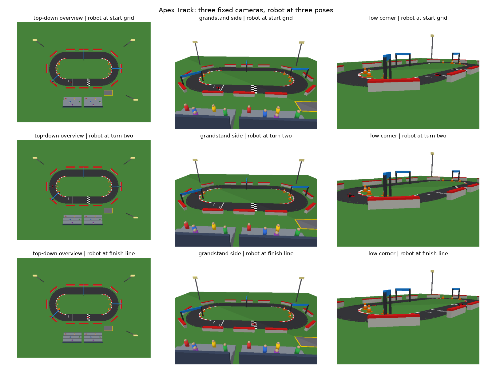 | 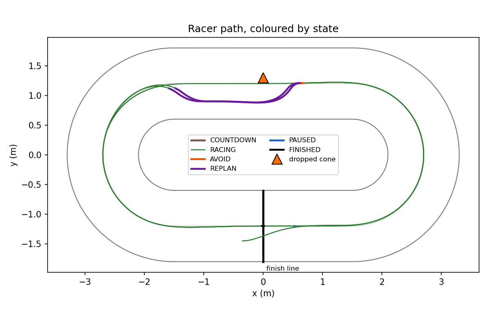 |

Two car run: the racer passes the parked player car (blue square) on every lap and the cone on laps 2 and 3.

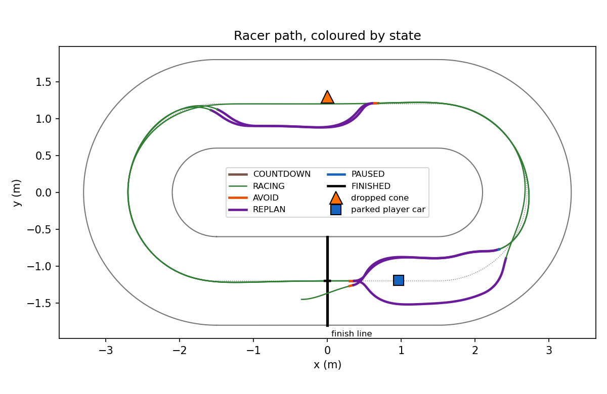

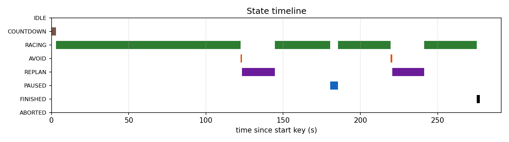
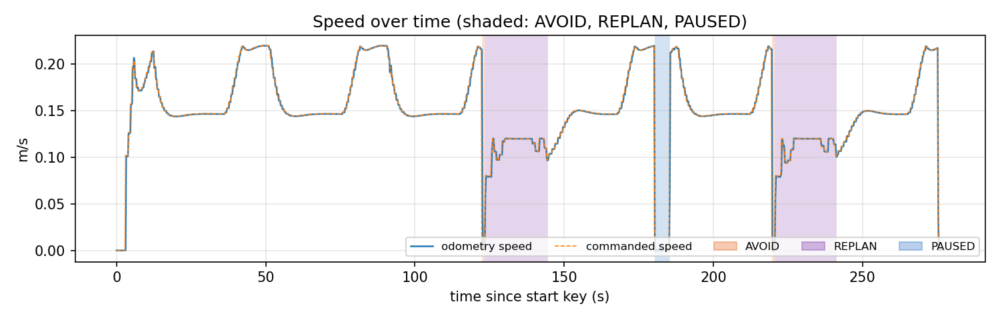
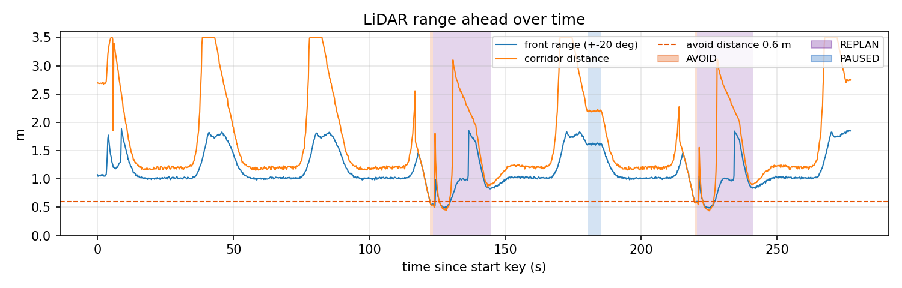

2D LiDAR map built by slam_toolbox during a two car run. The black dot on the back straight is the cone, and the one on the front straight is the parked player car. See [2D LiDAR map](#2d-lidar-map).

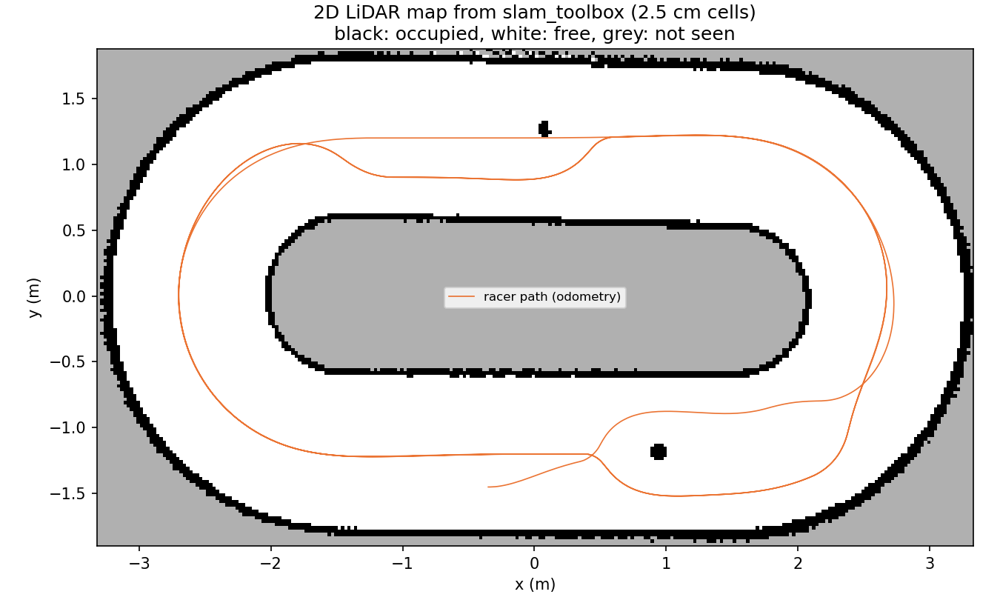

Gazebo screenshots are taken by hand. See `docs/screenshot_list.md`.

## Run it

### Task 1 (about 10 s to run the notebook)

1. Install `uv` once, if it is missing: `curl -LsSf https://astral.sh/uv/install.sh | sh`
2. Make the venv: `uv venv --python 3.11 task1_pybullet/.venv`
3. Install the packages: `VIRTUAL_ENV=task1_pybullet/.venv uv pip install -r task1_pybullet/requirements.txt`
4. Run the notebook: `cd task1_pybullet && .venv/bin/jupyter nbconvert --to notebook --execute --inplace apex_track.ipynb`
   Or open it with `.venv/bin/jupyter lab` and use Restart and Run All.

### Task 2

`task2_ros2/RUN_ME.ipynb` has every command in order, with the time each step took. In short:

1. Build the image once: `docker build -t apex:humble task2_ros2/docker`
2. Start the container with the display: `task2_ros2/docker/run.sh`
3. Inside it, build the package: `cd /ws && colcon build --symlink-install --base-paths src/apex/task2_ros2 && source install/setup.bash && cd /ws/src/apex/task2_ros2`
4. Start the race: `ros2 launch apex_race race.launch.py player:=true` (leave out `player:=true` for one car)
5. In a second terminal (`task2_ros2/docker/exec.sh`), start the keyboard: `ros2 run apex_race keyboard_node --ros-args --params-file apex_race/config/params.yaml`
6. Press `g` to start. On lap 3 press `p`, wait, press `p` again. Drive the blue car with `w a s d`.
7. After the race: `python3 scripts/analyze_run.py runs/<timestamp>`

To build the 2D map as well, add `slam:=true` in step 4. Add `rviz:=true` too to watch the map grow live in RViz (see [Live view in RViz](#live-view-in-rviz)). Before you stop the launch, save the map from another container shell: `ros2 run nav2_map_server map_saver_cli -f runs/<timestamp>/map --ros-args -p use_sim_time:=true`. Then draw it: `python3 scripts/plot_map.py runs/<timestamp>`.

For a run with no window and scripted keys: `task2_ros2/docker/run.sh --headless`, then `docker exec apex bash -c 'source /opt/apex_env.sh && cd /ws && colcon build --symlink-install --base-paths src/apex/task2_ros2 && source install/setup.bash && cd src/apex/task2_ros2 && scripts/headless_run.sh'`. Add `player` to spawn the second car and `slam` to build and save the map, for example `scripts/headless_run.sh player slam`.

## Assignment mapping

The full assignment brief was not in the repo when I built this, so the mapping follows the checklist in my project brief.

### Task 1

| Requirement | What Apex does | File |
|---|---|---|
| Four or more URDF models with distinct roles | Eight scenery models: barrier and cone (obstacle), checkpoint gate (target), finish pad (target zone), pit box (zone), grandstand and light tower (landmark), spectator (audience) | `task1_pybullet/apex_track.ipynb`, section 2 |
| One two-wheel robot URDF | `racer.urdf`: two driven wheels on continuous joints, a caster ball, a chassis, a rear wing | same, section 2 |
| Eight or more objects plus the robot in a meaningful scene | 38 scenery bodies on an oval circuit, plus the racer | same, section 3 |
| Roles stored in code, objects identified by code | `REGISTRY` dict keyed by body id; `objects_by_role`, `describe`, `nearest_object`, `zone_at` | same, section 4 |
| DIRECT mode | `p.connect(p.DIRECT)` and the tiny renderer | same, section 1 |
| Three camera views, static objects fixed, robot moved | Top-down, grandstand and low corner cameras at three racer poses; assert that 40 static poses match | same, sections 5 to 7 |
| All objects and the robot visible across views | Segmentation mask asserts: racer in all 9 images, every body id in at least one | same, section 7 |
| One interaction or query | Highlight all obstacles, nearest object per pose, role lookup by position | same, section 8 |
| Matplotlib display | Every image shown with a title | same, sections 6 and 8 |
| Reflection with failed attempts | DRAFT reflection built from the attempts log | same, section 9; `docs/attempts.md` |

### Task 2

| Requirement | What Apex does | File |
|---|---|---|
| A use case | A three lap time trial through a closed circuit, with a cone dropped mid race and a second car driven by a person | `task2_ros2/` |
| A TurtleBot simulation | Two TurtleBot3 Burgers in Gazebo Classic 11 on ROS 2 Humble, in Docker | `task2_ros2/docker/`, `apex_race/launch/race.launch.py` |
| Two sensor types | LiDAR on `/auto/scan` (stop, free space, side choice, contact metric) and odometry on `/auto/odom` (pose for pure pursuit, lap timing, distance) | `apex_race/race_controller_node.py`, `monitor_node.py` |
| Obstacle avoidance or waypoint navigation | Both: pure pursuit over 136 centre line waypoints, and AVOID and REPLAN around obstacles seen in the scan | `apex_race/pursuit.py`, `apex_race/replan.py` |
| Keyboard interaction | `g` start, `p` pause or resume, `x` abort, `r` reset, `w a s d` drive the player car | `apex_race/keyboard_node.py` |
| A state machine with five or more states | Eight states in one transition table with no ROS imports | `apex_race/state_machine.py` |
| A monitoring feature | One sentence per state change, `/apex/status` once a second, and `events.csv`, `ticks.csv` and `summary.json` per run | `apex_race/monitor_node.py` |
| One complete mission with logs, screenshots and text | Three laps, cone on lap 2, one pause and resume, summary printed at the end | `task2_ros2/results/`, `docs/screenshot_list.md` |
| A notebook with every run command | Every command in order, with measured times | `task2_ros2/RUN_ME.ipynb` |

## Architecture

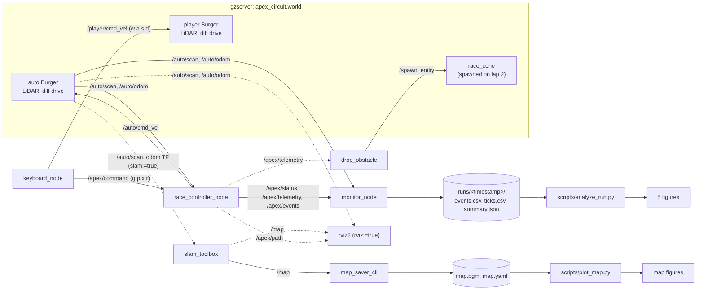

The race controller keeps all ROS code out of the maths. The pure modules are `state_machine.py`, `pursuit.py`, `laps.py`, `replan.py` and `track.py`. They have unit tests and run without ROS.

## State machine

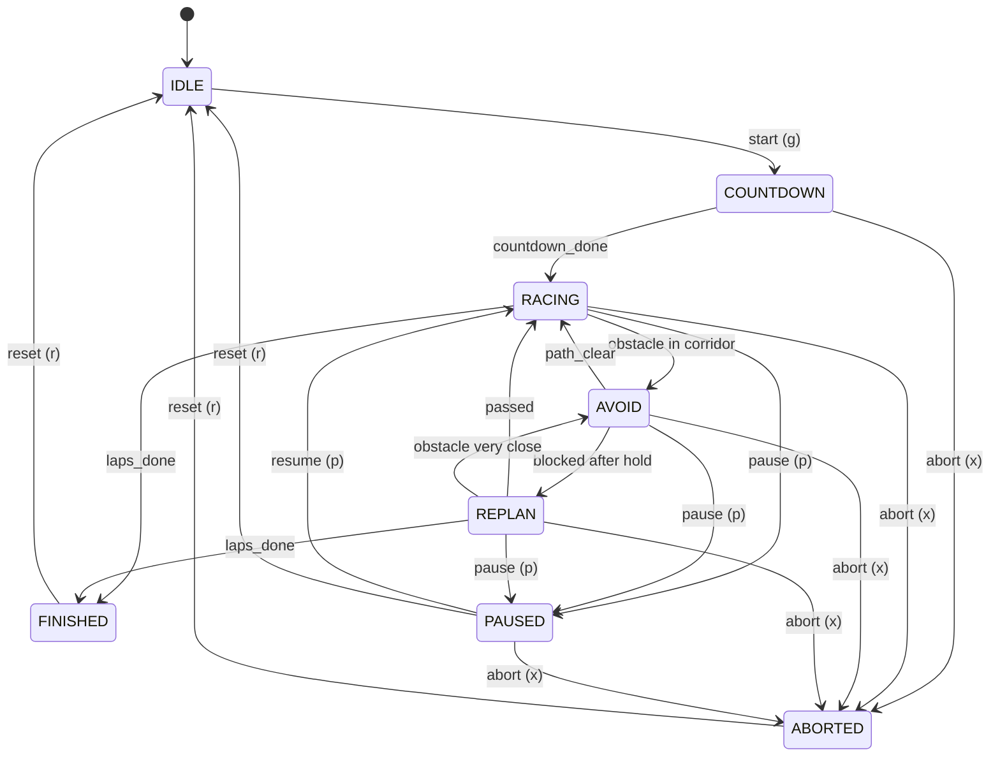

### States

| State | What the racer does | Leaves when |
|---|---|---|
| IDLE | Stands still on its grid slot | `g` is pressed |
| COUNTDOWN | Stands still and logs 3, 2, 1, Go | 3 s have passed, or `x` |
| RACING | Pure pursuit over the centre line. Speed drops as curvature rises | Something enters the corridor within 0.6 m, all laps are done, `p`, or `x` |
| AVOID | Stops and watches the corridor ahead | The corridor is clear beyond 0.8 m (to RACING), or it is still blocked after 1 s (to REPLAN) |
| REPLAN | Compares free space beside the obstacle, shifts the next 22 waypoints to the open side, drives the new line at 0.12 m/s | It is past the shifted stretch, or something comes within 0.15 m right in front |
| PAUSED | Stands still. Race time stops | `p` (to RACING), `x`, or `r` |
| FINISHED | Stands still. The summary is printed | `r` |
| ABORTED | Stands still. The summary is written | `r` |

Every transition is logged as one sentence, for example `Obstacle 0.58 m ahead. RACING to AVOID.`

## Maths

All of these are pure functions with unit tests.

* Pure pursuit: curvature = 2 * y / L^2, where y is the left offset of the lookahead point in the robot frame and L is its distance (`pursuit.curvature`).
* Speed from curvature: v = v_max / (1 + 0.6 * |curvature|), clamped to [0.08, 0.22] m/s (`pursuit.speed_for_curvature`). On this circuit that gives 0.22 m/s on the straights and about 0.147 m/s in the turns.
* Lap timing: a lap counts when the step from the last pose to the new one crosses the finish line segment in the forward direction, at least 20 s after the last crossing (`laps.LapTimer`). The first crossing starts lap 1. Paused time is not counted.
* REPLAN: the scan points within 1 m ahead are split into the obstacle (grown out from the points inside the corridor) and the rest. The free space on each side is the gap from the obstacle's edge to the next point on that side. The racer takes the side with more space (`replan.free_beside`, `replan.choose_side`). It shifts the waypoints so its centre line passes 0.25 m beyond the obstacle's edge, between 0.30 and 0.38 m (`replan.pass_offset`, `replan.shift_waypoints`).
* Contact event: the lowest valid LiDAR range drops below 0.15 m. It ends when the range rises above 0.20 m, and each event counts once (`replan.ContactCounter`). The LiDAR cannot measure below 0.12 m, so 0.15 m means the body is about 5 to 8 cm from the object.

## Parameters

All tunable values live in `task2_ros2/apex_race/config/params.yaml`. The circuit layout lives in `config/circuit.yaml`.

| Parameter | Value | Meaning |
|---|---|---|
| `laps` | 3 | Laps in the race |
| `control_rate` | 10 Hz | Control loop and telemetry rate |
| `countdown_s` | 3 s | Countdown before the start |
| `lookahead` | 0.45 m | Pure pursuit lookahead while racing |
| `v_max`, `v_min` | 0.22, 0.08 m/s | Speed limits. 0.22 m/s is the Burger's real top speed |
| `curvature_gain` | 0.6 | How fast speed drops with curvature |
| `w_max` | 1.5 rad/s | Turn rate limit |
| `corridor_half_width` | 0.17 m | Half width of the corridor checked ahead |
| `avoid_distance` | 0.6 m | Corridor hit closer than this: RACING to AVOID |
| `clear_distance` | 0.8 m | Corridor empty this far: AVOID to RACING |
| `avoid_hold_s` | 1.0 s | Time stopped in AVOID before REPLAN |
| `gap_ahead`, `gap_cap` | 1.0 m, 1.0 m | Scan window and cap for the free space comparison |
| `replan_clearance` | 0.25 m | From the obstacle's edge to the racer's centre line |
| `replan_offset_min`, `replan_offset_max` | 0.30, 0.38 m | Limits on the sideways shift |
| `replan_offset_step` | 0.04 m | Extra shift on each retry for the same obstacle |
| `replan_points`, `replan_ramp` | 22, 3 | Waypoints shifted, and waypoints used to ramp the shift |
| `replan_speed`, `replan_lookahead` | 0.12 m/s, 0.25 m | Speed and lookahead while in REPLAN |
| `replan_stop_distance`, `replan_stop_half_width` | 0.15 m, 0.10 m | Safety band in REPLAN |
| `min_lap_time` | 20 s | Ignore finish line crossings closer together than this |
| `contact_enter`, `contact_exit` | 0.15, 0.20 m | Contact event thresholds (monitor) |
| `tick_rate` | 5 Hz | Rows per second in `ticks.csv` |
| `lin_step`, `ang_step` | 0.05 m/s, 0.3 rad/s | Change per key press for the player car |
| drop `lap`, `trigger_x` | 2, 1.0 m | The cone drops on lap 2, once the racer passes x = 1.0 m on the front straight |
| drop `cone_x`, `cone_y` | 0.0, 1.3 m | Where the cone lands: back straight, 0.1 m toward the outer wall |

## Topics

| Topic | Type | From | To |
|---|---|---|---|
| `/auto/scan` | sensor_msgs/LaserScan, 5 Hz | Gazebo | race_controller_node, monitor_node |
| `/auto/odom` | nav_msgs/Odometry | Gazebo | race_controller_node, monitor_node |
| `/auto/cmd_vel` | geometry_msgs/Twist | race_controller_node | Gazebo |
| `/player/cmd_vel` | geometry_msgs/Twist | keyboard_node | Gazebo |
| `/player/scan`, `/player/odom` | as above | Gazebo | (free for your own use) |
| `/apex/command` | std_msgs/String, one key | keyboard_node | race_controller_node |
| `/apex/status` | std_msgs/String (JSON), 1 Hz | race_controller_node | you (`ros2 topic echo`) |
| `/apex/telemetry` | std_msgs/String (JSON), 10 Hz | race_controller_node | monitor_node, drop_obstacle |
| `/apex/events` | std_msgs/String (JSON) | race_controller_node, drop_obstacle | monitor_node |
| `/spawn_entity`, `/gazebo/set_entity_state`, `/delete_entity` | services | Gazebo | drop_obstacle, race_controller_node (reset) |
| `/tf` (odom to base_footprint), `/tf_static` (base_footprint to base_scan) | TF, only with `slam:=true` | Gazebo, static_transform_publisher | slam_toolbox |
| `/map` | nav_msgs/OccupancyGrid, only with `slam:=true` | slam_toolbox | map_saver_cli, rviz2 |
| `/apex/path` | nav_msgs/Path, transient local, odom frame | race_controller_node, at start and each time REPLAN shifts or restores the waypoints | rviz2 |

`/apex/status` carries state, lap, speed, distance, front range and race time.

## Results

Every number here comes from a logged run in `task2_ros2/results/`. Both final runs are headless, with the keys pressed by `scripts/mission_driver.py` as topic messages. The GUI run with real key presses is still to do (see `docs/screenshot_list.md`).

| | One car | Two cars |
|---|---|---|
| Run | `one_car_20261008_210907` | `player_20261008_211917` |
| Result | FINISHED | FINISHED |
| Lap times | 80.0 s, 92.1 s, 92.4 s | 89.7 s, 103.2 s, 101.7 s |
| Total race time (pause not counted) | 267.4 s | 297.5 s |
| Distance driven | 41.33 m | 41.76 m |
| Contact events | 0 | 0 |
| Lowest clearance (lowest LiDAR range) | 0.252 m | 0.225 m |
| AVOID / REPLAN count | 2 / 2 | 5 / 5 |
| Pauses | 1 | 1 |
| Wall clock for the whole script | 4 min 42 s | 5 min 27 s |

The mission repeats closely. A second one car run, on a fresh container from the README command (`runs/20261008_215110`, not committed), gave 80.0, 92.1 and 92.3 s, 0 contact events and 41.33 m.

What happened in the one car run:

* Lap 1 had nothing on the track and took 80.0 s. Speed was 0.22 m/s on the straights and about 0.147 m/s in the turns, as the curvature rule predicts.
* On lap 2, at 87.5 s, the cone dropped on the back straight at (0.00, 1.30), 0.1 m toward the outer wall. At 119.5 s the log reads `Obstacle 0.58 m ahead. RACING to AVOID.` One second later the cone was still there: `AVOID to REPLAN`, then `Free space left 0.63 m, right 0.41 m. Shifting the next 22 waypoints 0.30 m to the left.` The racer passed inside the cone and returned to RACING at 141.6 s.
* The cone stays on the track, so lap 3 had the same pass, with almost the same readings (0.63 m left, 0.42 m right).
* At the start of lap 3 the pause key put the racer in PAUSED, and the resume key 5 s later put it back in RACING. Race time does not count paused time.

What happened in the two car run:

* The player car was parked at (0.96, -1.19), on the racing line just after the finish line, before the start key.
* The racer met it on every lap. The free space read 0.48 m left and 0.44 m right on lap 1, and about 0.54 m on each side on laps 2 and 3. It passed on the left, then the right, then the left. The racer also passed the cone on laps 2 and 3. Every pass ended in RACING, and no contact event happened.
* Three earlier player car runs went wrong. In one the racer touched the parked car twice. In one it touched the car three times and then got wedged beside it. In one the scripted player car squeezed it at the start. Each is in `docs/attempts.md`, with the fix that followed.

Known limits:

* The racer only checks the corridor ahead. A car that drives in from the side can still touch it (attempts log, run `20261008_211402`).
* Odometry here is the Gazebo diff drive plugin's default world based odometry, so `/odom` has no drift. On a real Burger, wheel odometry drifts, and the lap timing and pure pursuit would need a localisation source.
* Contact events come from the LiDAR, not from a bumper sensor. A touch below the LiDAR plane, for example by a wheel, is only seen as a low range.

## 2D LiDAR map

With `slam:=true` the launch also starts slam_toolbox (online async mode). It builds a 2D occupancy map from the racer's LiDAR while the racer drives the normal mission. The settings are in the `slam_toolbox` section of `params.yaml`: 2.5 cm cells, 3.5 m range (the Burger LiDAR's limit), and a new scan every 0.2 m or 0.3 rad. The other scan matcher settings are slam_toolbox's defaults. The headless script saves the map at the end with `map_saver_cli`.

Two checks make the map honest:

* **Against the real walls.** `scripts/plot_map.py` takes every occupied cell and measures its distance to the nearest wall face from `circuit.yaml`. Cells more than 15 cm from both walls are grouped and listed as other objects.
* **Against the true pose.** `/odom` here is Gazebo's true pose, so the map frame should sit exactly on the odom frame. `scripts/slam_offset.py` records slam_toolbox's map to odom correction during the run. That correction is the SLAM pose error.

| Run | Cars | Occupied cells within 5 cm of a wall | Median / 95th percentile distance | Other objects found (15 cm or more off the walls, 5+ cells) | Largest SLAM pose error |
|---|---|---|---|---|---|
| `map_one_car_20261009_002750` | 1 | 89% (2300 of 2588) | 2.1 cm / 5.7 cm | cone at (0.03, 1.26) | not recorded |
| `map_one_car_20261009_004641` | 1 | 72% (2118 of 2926) | 3.3 cm / 7.8 cm | cone at (0.02, 1.24) | 11.6 cm, 11.8 deg |
| `map_player_20261009_003315` | 2 | 56% (1941 of 3450) | 4.1 cm / 21.4 cm | cone, player car, and smeared turn walls | not recorded |
| `map_player_20261009_004014` | 2 | 77% (2172 of 2832) | 2.8 cm / 8.2 cm | cone at (0.07, 1.26), player car at (0.94, -1.19) | 9.7 cm, 9.6 deg |

The cone really landed at (0.00, 1.30) and the player car was parked at (0.96, -1.19). The centres of the matching map cells sit 2 to 8 cm from those points. The LiDAR only sees the side of each object that faces the racer, so those centres sit a little toward the track. The free track area in the maps is 15.1 to 15.4 m².

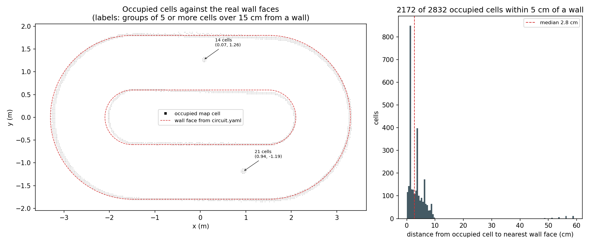
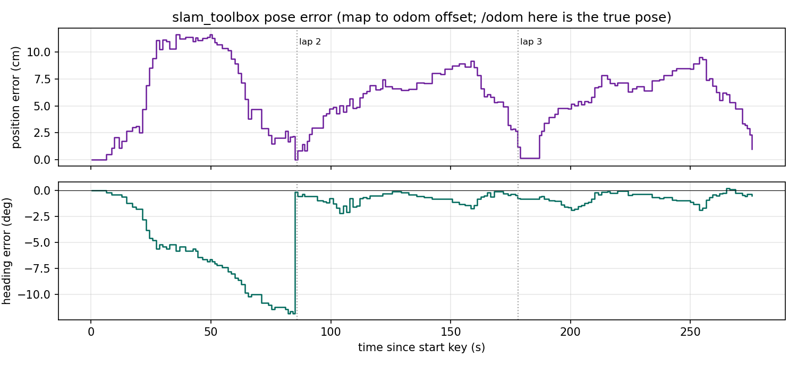

What the runs show:

* In both runs with the error recorder, the heading error grows to about 10 to 12 degrees during lap 1. A loop closure as lap 2 begins pulls it back to under 1 degree and 1 cm. For the rest of the race the error stays under 3.7 degrees and 9.5 cm.
* Map quality changes from run to run. Run `003315` drifted more in lap 1, and its outer walls in both turns came out thick and doubled, up to about 0.25 m inside the real face. I did not tune the scan matcher to hide this.
* The racing does not change with mapping on. The one car mapping runs gave 80.0, 92.1 and 92.3 s and 80.0, 92.1 and 92.4 s, with 0 contact events, the same as without it.
* slam_toolbox never sees outside the walls. The walls are 0.3 m tall and the LiDAR sits 0.18 m up, so the grandstands, pit lane and the infield all stay grey (not seen).
* The racer drives on the true pose from `/odom`, not on the map. The map is a product of the run, not an input to it.

### Live view in RViz

`ros2 launch apex_race race.launch.py slam:=true rviz:=true` opens RViz with `apex_race/config/apex_map.rviz`. It is a top-down view in the map frame with five layers:

* **Live map:** `/map` from slam_toolbox, updated every 2 s.
* **Racing line:** `/apex/path`, the waypoints the racer is following. In REPLAN you see the line bend around the obstacle, and it snaps back once the racer is past.
* **LiDAR scan:** `/auto/scan` as red points.
* **Racer trail:** poses from `/auto/odom` as orange arrows, one every 0.1 m or 0.3 rad, up to the last 300.
* **Frames:** the map, odom, base_footprint and base_scan axes.

`rviz:=true` needs `slam:=true`, because the map and odom frames come from slam_toolbox. Without it the launch prints a note and skips RViz.

The screenshots below are real RViz frames from run `rviz_live_20261009`. I took them on a virtual screen (Xvfb) inside the container, because my shell has no access to the laptop screen. The racer ran the normal one car mission with scripted keys: 80.0, 92.1 and 92.3 s, 0 contact events (`summary.json` and `events.csv` are in the same folder).

| Lap 1, map half built | Lap 2, REPLAN around the cone | Race over |
|---|---|---|
| 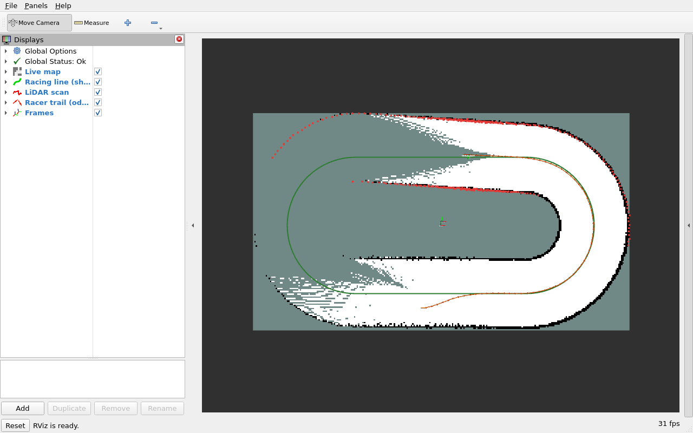 | 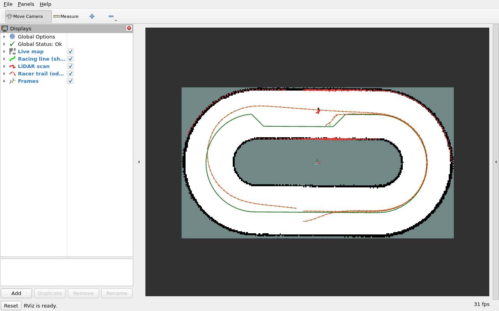 | 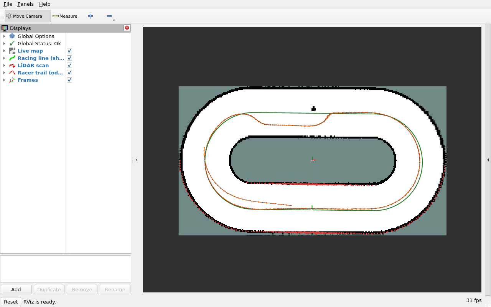 |

In the lap 1 part of the trail you can see the SLAM drift from the table above. RViz places each trail arrow with the map to odom correction it had when that arrow arrived. During lap 1 that correction drifts by up to about 10 degrees, so those arrows sit off the racing line. After the loop closure at the start of lap 2, the new arrows sit close to the line again. The trail keeps only 300 arrows, so by the end most of lap 1 has dropped off.

## Tests

* Task 1: `Restart and Run All` finishes with no errors. The notebook asserts that static poses match across captures, that the racer shows in all 9 images, and that every body id shows in at least one.
* Task 2: 42 unit tests for the pure modules (`cd task2_ros2/apex_race && python3 -m pytest -q test`). They cover the transition table, the curvature formula against a known circle, the speed curve, finish line crossings and their direction, the free space measure, the waypoint shift, the contact counter, and the robot model's odom TF switch for mapping.
* Task 2 end to end: `scripts/headless_run.sh` runs the full mission with no window and scripted keys. `scripts/headless_run.sh slam` also builds the map and saves it.
* Figures: I redrew every committed figure from its saved run files (`analyze_run.py`, `plot_map.py`) and re-ran the Task 1 notebook from scratch. All 10 Task 2 figures and all 4 Task 1 figures came out byte for byte the same as the committed ones.

## Layout

```
README.md
docs/
  attempts.md            every failed approach, with what broke and what came next
  screenshot_list.md     screenshots to take by hand
task1_pybullet/
  apex_track.ipynb       the notebook, committed with outputs
  requirements.txt
  figures/               images saved by the notebook
task2_ros2/
  RUN_ME.ipynb           every command, in order, with times
  docker/                Dockerfile, run.sh, exec.sh, entrypoint.sh, apex_env.sh
  apex_race/             the ROS 2 package
    apex_race/           nodes and pure modules
    config/              params.yaml, circuit.yaml, apex_map.rviz
    launch/              race.launch.py
    worlds/              apex_circuit.world (generated)
    test/                unit tests
  world_gen/             generate_world.py
  scripts/               analyze_run.py, plot_map.py, slam_offset.py, headless_run.sh,
                         mission_driver.py, make_run_me.py
  results/               the runs used in this README
  runs/                  every run (not committed)
```
